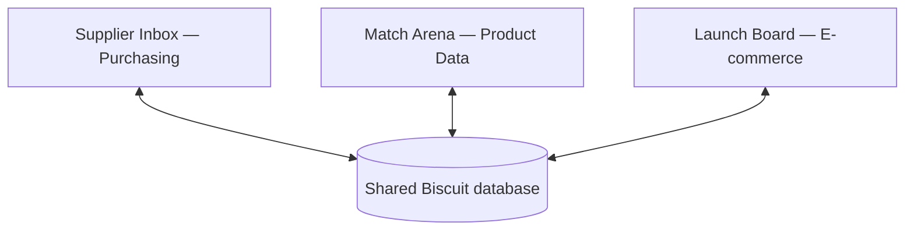

# SKUpermatch

From supplier chaos to shop-ready products.

Built for the Building Better Worlds Hackathon, Vienna, 13–14 November 2026.
Biscuit Track — Build the Missing Tools.
Team: Die Drei Muskeltiere.

SKUpermatch connects Purchasing, Product Data and E-commerce through three
Biscuit apps sharing one database.

The name combines SKU (Stock Keeping Unit) and matching: deciding whether
a supplier item belongs to an existing shop product or represents a
different product or variant.

## Problem

Respawn Retail is a fictional online retailer of gaming and technology
accessories.

Supplier lists contain inconsistent product names, missing attributes and
similar-looking variants. Purchasing, Product Data and E-commerce need to
clarify these differences before an item can be approved for the shop.

Multiple suppliers may offer the same product. Conversely, two products
with similar names may differ in variant or pack size.

## Solution

### Supplier Inbox — Purchasing

Purchasing creates supplier items and answers clarification questions.
The information stays connected to the item throughout the review process.

### Match Arena — Product Data and Quality

Product Data selects or confirms the candidate shop product in Match Arena.
The team reviews discrepancies, requests clarification and confirms the
appropriate product relationship.

### Launch Board — E-commerce and Assortment

E-commerce sees the item's readiness and the specific blockers preventing
internal approval. It completes the required information and selling price
before approving the item internally.

## Implementation status

| App or capability | Status |
| --- | --- |
| Supplier Inbox | Implemented in Biscuit |
| Match Arena | Implemented in Biscuit |
| Launch Board | Implemented in Biscuit |
| End-to-end workflow across the three apps | Implemented in Biscuit |
| Shared database | Implemented in Biscuit |
| Cross-app visibility of changes | Implemented in Biscuit |
| Release blockers calculated on each query | Implemented in Biscuit |
| Repository documentation | Prepared |
| Demo video | Planned |
| CSV import | Not in scope for this MVP |
| AI suggestions | Not in scope for this MVP |

## Architecture

The three apps read and write the same shared database rather than
maintaining separate copies.

The team observes changes, such as new supplier items and clarification
answers, appearing in the other apps usually within seconds without
manual refresh. This is observed behaviour, not a guaranteed latency.

Launch Board release blockers are not stored as a separate list.
They are recalculated on every query using current data and rules.
This avoids relying on an outdated saved blocker list.

Recalculation happens when a query is made; it is not a guarantee of
continuous screen updates.

## Tech stack

- Biscuit: application runtime and shared database.
- Markdown: project and evaluation documentation.
- GitHub: public documentation repository.

The apps run on Biscuit. This repository is not a standalone application
or an executable export.

## How to evaluate

### Environment, setup and run

The apps run in a private Biscuit workspace. There are no public app links.

The jury sees the implementation through the live demo and demo video.
Authorized workspace users can sign in to Biscuit, open the project and
open Supplier Inbox, Match Arena and Launch Board. These are
team-verified project steps, not public API or CLI instructions.

There is no local installation or run command. No local environment
variables are required for this viewing workflow; see `.env.example`.

### Eight-step demonstration

1. Purchasing creates a supplier item in Supplier Inbox.
2. The same item appears in Match Arena.
3. Product Data notices a pack-size discrepancy and requests clarification.
4. The question appears in Supplier Inbox.
5. Purchasing answers and corrects the supplier information where appropriate.
6. Product Data resolves the question and confirms the correct match.
7. The resulting state and blockers appear in Launch Board.
8. E-commerce completes the required information and selling price,
   then approves internally when all release conditions are satisfied.

For this demonstration, the pack-size discrepancy is an incorrect
supplier-data entry that can be clarified and corrected. A genuine
two-pack must not be treated as a single unit merely to complete a match.

See the [three-minute demo script](https://github.com/dariopino-cloud/skupermatch/blob/main/docs/demo-script.md).

### What to look for

- The same supplier item moves through all three apps.
- Clarification travels from Product Data to Purchasing and back.
- Similar variants are not automatically treated as the same product.
- Rejecting a match does not make an item ready for sale.
- Internal approval depends on the complete release checklist.

## Internal release checklist

The business process requires:

- A confirmed match or confirmed creation of a new shop product.
- Complete required product attributes.
- An entered selling price.
- No open clarification question.

Internal approval is a workflow state, not publication to an external shop.

## Documentation

- [Business process](https://github.com/dariopino-cloud/skupermatch/blob/main/docs/process.md)
- [Data model](https://github.com/dariopino-cloud/skupermatch/blob/main/docs/data-model.md)
- [App connections](https://github.com/dariopino-cloud/skupermatch/blob/main/docs/app-connections.md)
- [Demo script](https://github.com/dariopino-cloud/skupermatch/blob/main/docs/demo-script.md)

## Assumptions and limitations

- Respawn Retail and the demonstration business scenario are fictional.
- Demo data and app definitions live in the private Biscuit workspace and are not exported as files.
- No CSV files or saved original build prompts are included.
- The repository documents the project; it cannot independently launch
  or reconstruct the complete Biscuit implementation.
- Not yet tested with separate user accounts.
- Observed cross-app updates are not a measured synchronization guarantee.
- On-query blocker calculation does not by itself imply automatic
  withdrawal of an earlier approval.
- There is no actual shop upload or ERP integration in this MVP.
- CSV import and AI suggestions are not in scope for this MVP.
- No measured time savings, matching accuracy or user adoption figures
  are claimed.

## Demo video

TODO: add video link

## Team

Die Drei Muskeltiere:

- Dario
- Sudhin Hegde
- Kushal Patel

## License

MIT. See [LICENSE](https://github.com/dariopino-cloud/skupermatch/blob/main/LICENSE).
