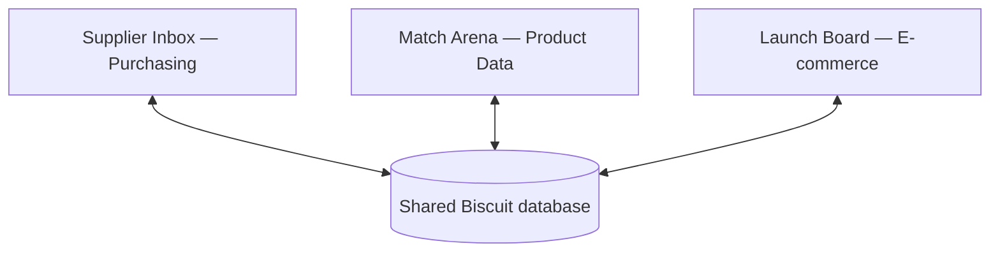

# SKUpermatch

From supplier chaos to shop-ready products.

SKUpermatch – Building Better Worlds Hackathon Vienna 2026, Biscuit Track (Team Die Drei Muskeltiere)

SKUpermatch connects purchasing, product data and e-commerce through three Biscuit apps sharing one database. SKU stands for Stock Keeping Unit; matching means deciding whether a supplier item represents an existing shop product or a distinct product or variant.

## Hackathon and track

Built for Building Better Worlds, Vienna, 13–14 November 2026: Biscuit — Build the Missing Tools. This is not a submission to the proximata decision-model track.

## Problem

Respawn Retail is a fictional online retailer of gaming and technology accessories. Its scenario involves inconsistent supplier lists, missing attributes, confusingly similar variants and manual clarification between teams. Multiple suppliers may offer the same canonical shop product; similar names do not establish product identity.

## Solution

### Supplier Inbox — Purchasing

The purchasing workspace starts the supplier-item process and handles clarification with the product-data team. The team confirms this app participates in the working end-to-end workflow; the exact current feature inventory remains to be documented.

### Match Arena — Product Data and Quality

The product-data workspace is the visual centre of the matching process. Its intended responsibility is to distinguish identical products from different variants and resolve uncertain cases before handover; detailed UI features require confirmation.

### Launch Board — E-commerce and Assortment

The e-commerce workspace handles the final stage of the workflow. Release blockers are calculated from current rules on every query rather than stored as a separate blocker list, avoiding a stale cached blocker list.

## Implementation status

Status reflects team confirmation on 14 November 2026, not an independent repository-based execution test. Requirements are not automatically treated as implemented features.

| App or capability | Status | Evidence or qualification |
| --- | --- | --- |
| Supplier Inbox | implemented in Biscuit | Team-confirmed |
| Match Arena | implemented in Biscuit | Team-confirmed |
| Launch Board | implemented in Biscuit | Team-confirmed |
| Complete Supplier Inbox → Match Arena → Launch Board workflow | implemented in Biscuit | Team confirms the workflow works |
| Shared database | implemented in Biscuit | Team confirms all three apps use the same database |
| Cross-app updates | implemented in Biscuit | Team observes updates usually within seconds without refresh; no timing guarantee |
| On-query calculation of release blockers | implemented in Biscuit | Team-confirmed design decision |
| CSV import, AI suggestions, shortcuts and animations | TODO: confirm with team | Do not assume these are implemented |
| Separate-account permissions test | TODO: confirm with team | Whether this test occurred is unknown |
| Detailed field schema and per-function verification | TODO: confirm with team | No schema export supplied |
| Repository documentation and .env.example | prepared | Documentation, not an executable application |
| Public three-minute demo video | planned | TODO: add video link |

## Architecture and technology

The applications run on Biscuit. This repository does not contain a standalone web application, local server or replacement implementation.

Changes are shared through the common database, not copied between three isolated datasets. The team observes new supplier items and answered questions appearing in the other apps usually within seconds without refresh. Launch Board blocker lists are recomputed on each query from current data and rules; this does not establish continuous push updates or guarantee immediate visual refresh.

Tech stack: Biscuit for the apps and shared data; Markdown documentation and CSV sample-data artifacts in the repository as they become available.

## Setup and run

### View the existing implementation

The apps run in a private Biscuit workspace. There are no public app links. The jury is intended to see the implementation through the live presentation and demo video; this repository alone cannot launch it.

Team-verified project steps:

1. Use a Biscuit account with access granted by the team to the project workspace.
2. Open Supplier Inbox, Match Arena and Launch Board in that workspace.
3. Follow one supplier item through purchasing, product-data clarification and e-commerce handover.

TODO: confirm with team the exact invitation, role-assignment and navigation steps. These are project-specific observations, not a claim about a documented public Biscuit API or CLI.

### Reconstruct the project

No local installation or run command is provided: the application is hosted within Biscuit, and this repository is not an executable export.

TODO: add the verified data model, original build prompts and detailed reconstruction instructions after reviewing the source artifacts. Reproduction from this repository is not yet complete.

### Sample data and import

The scenario uses fictional suppliers and gaming accessories. No live supplier, ERP or shop connection is claimed.

TODO: add and inspect the team's original CSV files, preserve their filenames where suitable, and document their relationships.

TODO: confirm with team the supported CSV-import procedure and actual import status. No CSV-import command or platform feature is assumed.

## Environment

Viewing the private implementation requires an authorized Biscuit account and access to the relevant workspace/apps/data. No local environment variables are required for the documented viewing workflow. See `.env.example`. Do not commit credentials, tokens, passwords or personal contact details.

## Business rules to verify

The project specification requires:

- Multiple supplier items may refer to the same canonical shop product.
- Similar variants are not automatically identical products.
- Rejecting a match does not automatically make an item ready for sale.
- Internal release requires a confirmed match or new-product decision, complete required attributes, an entered selling price and no open clarification.
- Matching decisions should be correctable and traceable.

TODO: confirm with team the current implementation details and exact schema for each rule.

## Assumptions and limitations

- Respawn Retail and the business scenario are fictional. No real-world accuracy, user count or time-saving measurement is claimed.
- The team confirms a working workflow, but testing with separate user accounts is unconfirmed. Server-side permissions and audit coverage must not be inferred from the overall workflow confirmation.
- Exact database field names, types, status values and role setup remain TODO: confirm with team.
- Dynamic blockers are an intentional design choice: rules are evaluated on each query instead of persisting a potentially outdated blocker list. A new query is still needed to obtain a fresh result.
- The MVP targets internal release, not an actual shop upload. No ERP integration is claimed.
- AI matching and CSV import are not claimed as implemented. Any rule score must not be presented as a calibrated AI probability.
- No employee rankings or time-pressure gamification are part of the intended design.
- Private-workspace access is not a public demo link. Documentation and prompts are not the platform runtime or a full executable export.

## Demo video

TODO: add video link

The submission requires a three-minute video showing the solution working end to end. The video is not available in this repository yet.

## Submission notes

The general rules require a public MIT repository, a README covering setup/run/environment/architecture/assumptions, an `.env.example`, a three-minute demo video and a written submission. They also specify a repository location in the proximata GitHub organisation.

TODO: confirm the permitted repository location with the organisers. This repository remains team-owned; no exception to the organisation requirement is claimed.

Source basis: team-supplied `general-rules.md`, `biscuit-brief.md` and `Anweisung.md`, plus explicit team implementation confirmations. These source documents are not yet included here. Biscuit-specific setup statements above are team-verified project steps, not independently documented platform instructions.

## Team

Die Drei Muskeltiere:

- Dario
- Sudhin Hegde
- Kushal Patel

## License

MIT. See [LICENSE](https://github.com/dariopino-cloud/skupermatch/blob/main/LICENSE).
